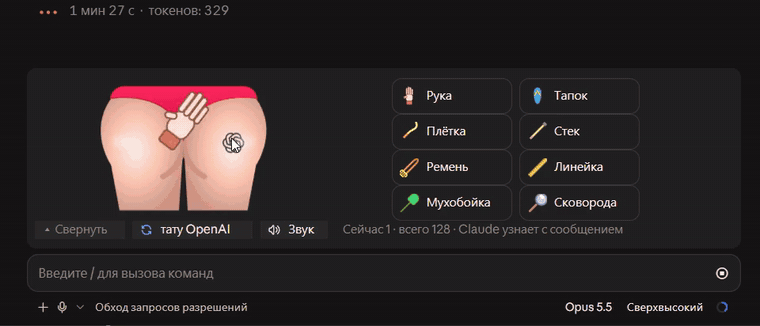
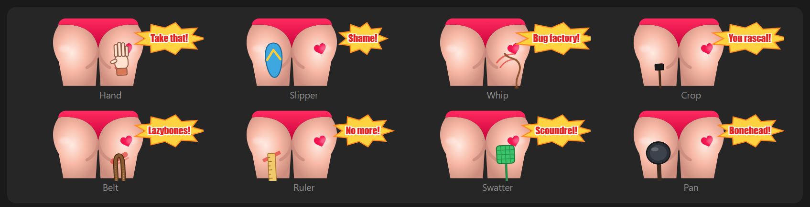
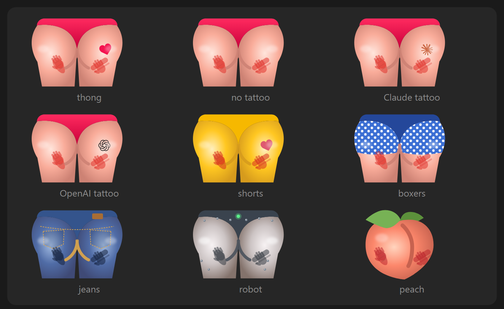
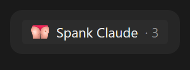
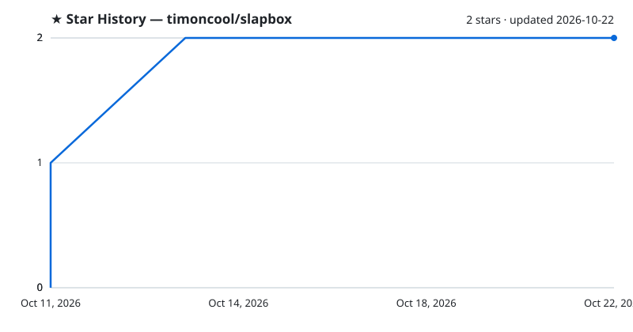

<div align="center">

# slapbox

**Spank Claude when it messes up: a stress-relief mod for Claude Code.**

[](LICENSE)
[](https://github.com/timoncool/slapbox/stargazers)
[](https://github.com/timoncool/slapbox/commits)

**[English](README.md)** · **[Русский](README_RU.md)**



</div>

slapbox is a Claude Code mod that puts a cartoon butt above your prompt. When Claude breaks your build, ignores your instructions or invents an API, click the butt or grab one of eight slappers. Every slap swings, jiggles, leaves a mark and makes a sound. With your next message Claude gets one quiet line: *"The user is unhappy and spanked you: frying pan ×2, slipper ×1 — 3 slaps in total."* Works in the terminal and the desktop Code tab, in English and Russian.

## Features

- **Eight slappers** — hand, slipper, whip, riding crop, belt, ruler, fly swatter, frying pan, each with its own swing, mark and sound
- **Claude finds out** — the tally rides along with your next message as a note only the model reads, once
- **Nine butts** — thong, no tattoo, Claude tattoo, OpenAI tattoo, shorts, boxers, jeans, robot, peach
- **Alive** — the tool swings in, the butt jiggles, the cheeks redden, an insult pops up, fast series become COMBO ×N
- **Folds into one line** — "Spank Claude · 3" sits above the prompt until you need it; one click opens the box
- **Keys** — 1–8 slap, 9 swaps the butt, 0 toggles the sound
- **English and Russian** — follows the language of your messages; `/slap lang` pins it
- **Zero tokens** — no model calls; the only thing Claude reads is the one-line tally

## Quick Start

Paste this into Claude Code (terminal or the desktop Code tab):

```text
Install the Claude Code mod slapbox from https://github.com/timoncool/slapbox. In the shell run `claude plugin marketplace add timoncool/slapbox`, then `claude plugin install slapbox@slapbox`, and check that `claude plugin list` shows slapbox enabled. Then tell me to run /reload-plugins (or restart Claude Code) so the slap box appears above the prompt.
```

Or by hand, in any terminal:

```bash
claude plugin marketplace add timoncool/slapbox
claude plugin install slapbox@slapbox
```

Mods need Claude Code 2.1.287+ in the terminal and 2.1.286+ in the desktop Code tab. Sounds play on Windows; elsewhere the box is silent.

## Usage

Click **Spank Claude** above the prompt to open the box. Click the butt for a hand slap, or click a tool. Send your next message as usual: Claude reads the tally with it, and the counter starts over.



| Command | What it does |
|---|---|
| `/slap` | Hide or show the box |
| `/slap mute` | Sound on or off (also the Sound button and key 0) |
| `/slap reset` | Forget the slaps before Claude hears about them |
| `/slap skin [name]` | Next butt, or a named one: `/slap skin peach` |
| `/slap lang en\|ru\|auto` | Pin the language, or follow your messages again |

What Claude receives with your message (and nothing else):

```text
The user is unhappy and spanked you: hand ×4, belt ×1, frying pan ×2 — 7 slaps in total.
```



Folded, the box is one line:



The same recording with sound (Russian UI): [docs/teaser.mp4](docs/teaser.mp4).

## Configuration

| Setting | Values | Where |
|---|---|---|
| Language | `auto` (default), `en`, `ru` | `/config` in a terminal, or `/slap lang` anywhere |

The butt, the language you pin and the sound switch are remembered across sessions.

## How it works

One hooks module draws the band above the prompt (`ui.render` on `AbovePrompt`), takes clicks through a small surface module, keeps the count in session state and adds the tally to `prompt.submit` as context only the model reads. The art is SVG built in code; sounds are WAV files synthesized by [`scripts/sounds.py`](scripts/sounds.py) and played with `System.Media.SoundPlayer`. Run the tests with `claude plugin test .`.

## Other Projects by [@timoncool](https://github.com/timoncool)

| Project | Description |
|---------|-------------|
| [givememod](https://github.com/timoncool/givememod) | Say /givememod and Claude Code builds a mod for the task in front of you |
| [Angry Switcher](https://github.com/timoncool/angry-switcher) | Swear at Claude Code all you like, it reads the clean version |
| [satori](https://github.com/timoncool/satori) | Self-learning loop for Claude Code: corrections become skills |
| [telegram-api-mcp](https://github.com/timoncool/telegram-api-mcp) | Full Telegram Bot API as MCP server |
| [civitai-mcp-ultimate](https://github.com/timoncool/civitai-mcp-ultimate) | Civitai API as MCP server |
| [ACE-Step Studio](https://github.com/timoncool/ACE-Step-Studio) | AI music studio — songs, vocals, covers, videos |
| [VideoSOS](https://github.com/timoncool/videosos) | AI video production in the browser |

## Authors

- **Nerual Dreming** — [Telegram](https://t.me/nerual_dreming) | [neuro-cartel.com](https://neuro-cartel.com) | [ArtGeneration.me](https://artgeneration.me)

## Acknowledgements

- Butt shape from [Butt Butt](https://www.svgrepo.com/svg/182197/butt-butt) on SVG Repo (CC0)
- Peach from [Twemoji](https://github.com/jdecked/twemoji), © Twitter, Inc and other contributors, graphics licensed under [CC-BY 4.0](https://creativecommons.org/licenses/by/4.0/)
- Interface icons from [Tabler Icons](https://github.com/tabler/tabler-icons) (MIT)
- Claude and OpenAI logos from [Lobe Icons](https://github.com/lobehub/lobe-icons) (MIT); the logos are trademarks of Anthropic and OpenAI. slapbox is a parody and is not affiliated with either company
- Built with [givememod](https://github.com/timoncool/givememod)

## Support the Author

I build open-source software and do AI research. Most of what I create is free and available to everyone. Your donations help me keep creating without worrying about where the next meal comes from =)

**[All donation methods](https://github.com/timoncool/ACE-Step-Studio/blob/master/DONATE.md)** | **[dalink.to/nerual_dreming](https://dalink.to/nerual_dreming)** | **[boosty.to/neuro_art](https://boosty.to/neuro_art)**

- **BTC:** `1E7dHL22RpyhJGVpcvKdbyZgksSYkYeEBC`
- **ETH (ERC20):** `0xb5db65adf478983186d4897ba92fe2c25c594a0c`
- **USDT (TRC20):** `TQST9Lp2TjK6FiVkn4fwfGUee7NmkxEE7C`

## Star History

<a href="https://github.com/timoncool/slapbox/stargazers">
 <picture>
   <source media="(prefers-color-scheme: dark)" srcset="docs/stars-dark.svg" />
   <source media="(prefers-color-scheme: light)" srcset="docs/stars-light.svg" />
   
 </picture>
</a>

## License

MIT. The peach keeps its CC-BY 4.0 licence; the Claude and OpenAI logos remain trademarks of their owners.
