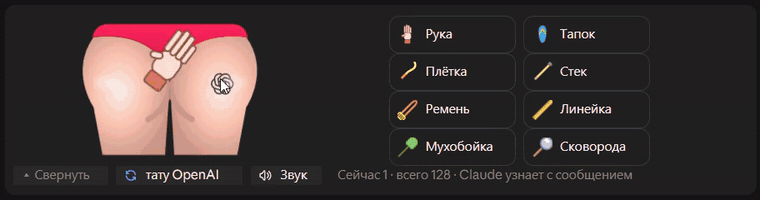
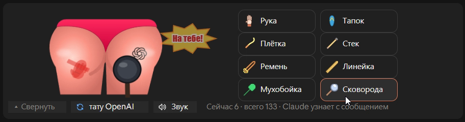
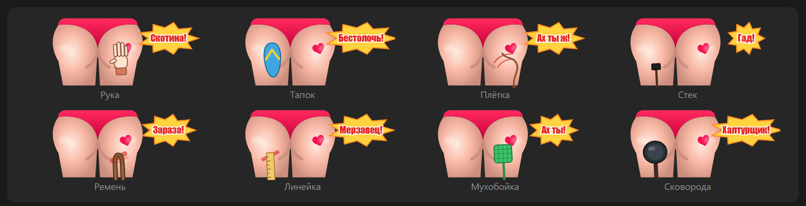
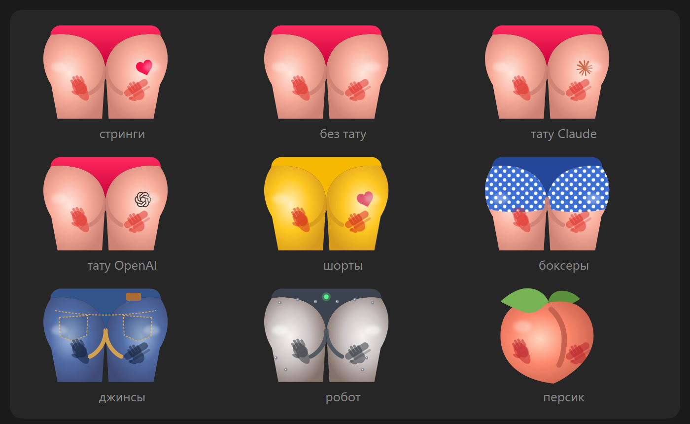
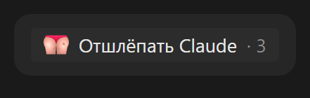

<div align="center">

# slapbox

**Отшлёпай Claude, когда он накосячил: мод для Claude Code, чтобы снять стресс.**

[](LICENSE)
[](https://github.com/timoncool/slapbox/stargazers)
[](https://github.com/timoncool/slapbox/commits)

**[English](README.md)** · **[Русский](README_RU.md)**



</div>

slapbox — мод для Claude Code: мультяшная попка над полем ввода. Claude сломал сборку, проигнорировал инструкцию или выдумал несуществующий API — кликни по попке или возьми одну из восьми шлёпалок. Каждый шлепок с замахом, дрожанием, следом и звуком. С твоим следующим сообщением Claude получает одну тихую строчку: *«Пользователь недоволен и отшлёпал тебя: сковородой ×2, тапком ×1 — всего 3 шлепка.»* Работает в терминале и во вкладке Code десктопного приложения, на русском и английском.

## Возможности

- **Восемь шлёпалок** — рука, тапок, плётка, стек, ремень, линейка, мухобойка, сковорода, у каждой свой замах, след и звук
- **Claude узнаёт** — счёт уходит вместе с твоим следующим сообщением заметкой, которую видит только модель, один раз
- **Девять попок** — стринги, без тату, тату Claude, тату OpenAI, шорты, боксеры, джинсы, робот, персик
- **Живая** — инструмент замахивается, попка трясётся, краснеет, выскакивает словечко, быстрая серия превращается в КОМБО ×N
- **Сворачивается в строку** — «Отшлёпать Claude · 3» висит над полем ввода, пока не понадобится; один клик — и шлёпалка открыта
- **Клавиши** — 1–8 шлёпают, 9 меняет попку, 0 включает и выключает звук
- **Русский и английский** — язык берётся из твоих сообщений; `/slap lang` его закрепляет
- **Ноль токенов** — никаких вызовов модели; Claude читает только строчку со счётом

## Быстрый старт

Вставь это в Claude Code (терминал или вкладка Code десктопного приложения):

```text
Install the Claude Code mod slapbox from https://github.com/timoncool/slapbox. In the shell run `claude plugin marketplace add timoncool/slapbox`, then `claude plugin install slapbox@slapbox`, and check that `claude plugin list` shows slapbox enabled. Then tell me to run /reload-plugins (or restart Claude Code) so the slap box appears above the prompt.
```

Или вручную, в любом терминале:

```bash
claude plugin marketplace add timoncool/slapbox
claude plugin install slapbox@slapbox
```

Моды работают в Claude Code 2.1.287+ в терминале и 2.1.286+ во вкладке Code десктопного приложения. Звук играет на Windows, на других системах шлёпалка беззвучная.

## Использование

Кликни «Отшлёпать Claude» над полем ввода, чтобы открыть шлёпалку. Клик по попке — шлепок рукой, клик по инструменту — шлепок им. Дальше пиши как обычно: Claude прочитает счёт вместе с сообщением, и счётчик начнётся заново.



| Команда | Что делает |
|---|---|
| `/slap` | Спрятать или показать шлёпалку |
| `/slap mute` | Звук вкл/выкл (то же кнопка «Звук» и клавиша 0) |
| `/slap reset` | Забыть шлепки, пока Claude о них не узнал |
| `/slap skin [имя]` | Следующая попка или по имени: `/slap skin персик` |
| `/slap lang ru\|en\|auto` | Закрепить язык или снова брать его из сообщений |

Что получает Claude вместе с твоим сообщением (и больше ничего):

```text
Пользователь недоволен и отшлёпал тебя: рукой ×4, ремнём ×1, сковородой ×2 — всего 7 шлепков.
```





Свёрнутая шлёпалка — одна строка:



Запись со звуком: [docs/teaser-ru.mp4](docs/teaser-ru.mp4).

## Настройки

| Настройка | Значения | Где |
|---|---|---|
| Language | `auto` (по умолчанию), `en`, `ru` | `/config` в терминале или `/slap lang` где угодно |

Попка, закреплённый язык и звук запоминаются между сессиями.

## Как это устроено

Один модуль хуков рисует полосу над полем ввода (`ui.render` на `AbovePrompt`), принимает клики через маленький поверхностный модуль, держит счёт в состоянии сессии и добавляет его в `prompt.submit` заметкой, которую читает только модель. Картинки — SVG, собранный в коде; звуки — WAV, синтезированные [`scripts/sounds.py`](scripts/sounds.py), играют через `System.Media.SoundPlayer`. Тесты: `claude plugin test .`.

## Другие проекты [@timoncool](https://github.com/timoncool)

| Проект | Описание |
|--------|----------|
| [givememod](https://github.com/timoncool/givememod) | Скажи /givememod — и Claude Code соберёт мод под текущую задачу |
| [Angry Switcher](https://github.com/timoncool/angry-switcher) | Ругайся на Claude Code сколько хочешь, он прочитает чистую версию |
| [satori](https://github.com/timoncool/satori) | Самообучение Claude Code: поправки становятся скиллами |
| [telegram-api-mcp](https://github.com/timoncool/telegram-api-mcp) | Telegram Bot API как MCP-сервер |
| [civitai-mcp-ultimate](https://github.com/timoncool/civitai-mcp-ultimate) | Civitai API как MCP-сервер |
| [ACE-Step Studio](https://github.com/timoncool/ACE-Step-Studio) | AI-студия музыки — песни, вокал, каверы, клипы |
| [VideoSOS](https://github.com/timoncool/videosos) | AI-видеопродакшн в браузере |

## Авторы

- **Nerual Dreming** — [Telegram](https://t.me/nerual_dreming) | [neuro-cartel.com](https://neuro-cartel.com) | [ArtGeneration.me](https://artgeneration.me)

## Благодарности

- Форма попки — [Butt Butt](https://www.svgrepo.com/svg/182197/butt-butt) с SVG Repo (CC0)
- Персик — [Twemoji](https://github.com/jdecked/twemoji), © Twitter, Inc and other contributors, графика под [CC-BY 4.0](https://creativecommons.org/licenses/by/4.0/)
- Иконки интерфейса — [Tabler Icons](https://github.com/tabler/tabler-icons) (MIT)
- Логотипы Claude и OpenAI — [Lobe Icons](https://github.com/lobehub/lobe-icons) (MIT); логотипы — товарные знаки Anthropic и OpenAI. slapbox — пародия и не связан ни с одной из компаний
- Сделано с помощью [givememod](https://github.com/timoncool/givememod)

## Поддержать автора

Я создаю опенсорс софт и занимаюсь исследованиями в области ИИ. Большая часть всего, что я делаю, находится в открытом доступе. Ваши пожертвования позволяют мне создавать и исследовать больше, не отвлекаясь на поиск еды для продолжения существования =)

**[Все способы поддержки](https://github.com/timoncool/ACE-Step-Studio/blob/master/DONATE.md)** | **[dalink.to/nerual_dreming](https://dalink.to/nerual_dreming)** | **[boosty.to/neuro_art](https://boosty.to/neuro_art)**

- **BTC:** `1E7dHL22RpyhJGVpcvKdbyZgksSYkYeEBC`
- **ETH (ERC20):** `0xb5db65adf478983186d4897ba92fe2c25c594a0c`
- **USDT (TRC20):** `TQST9Lp2TjK6FiVkn4fwfGUee7NmkxEE7C`

## Star History

<a href="https://github.com/timoncool/slapbox/stargazers">
 <picture>
   <source media="(prefers-color-scheme: dark)" srcset="docs/stars-dark.svg" />
   <source media="(prefers-color-scheme: light)" srcset="docs/stars-light.svg" />
   
 </picture>
</a>

## Лицензия

MIT. Персик остаётся под CC-BY 4.0; логотипы Claude и OpenAI — товарные знаки их владельцев.
